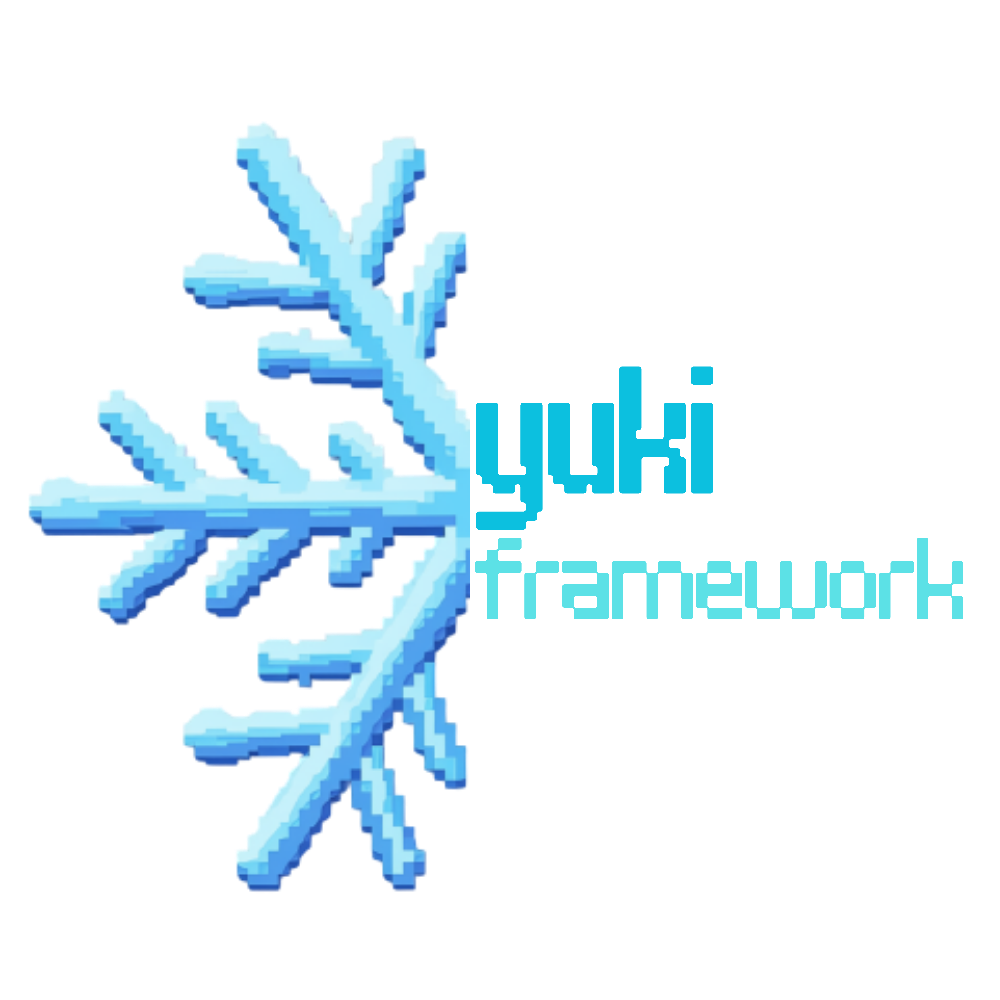
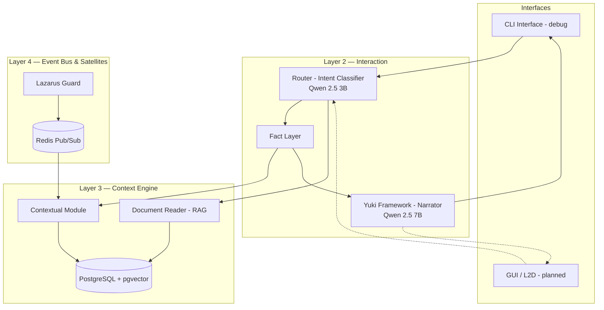

<div align="center">



# nexus-core

**Central Context Engine & AI Orchestrator for Project Nexus**

Part of [Project Nexus ](https://github.com/AyamGorengMadura/nexus-docs)


</div>

---

## 📖 Overview

**Nexus Core** is the orchestrator and central context engine behind Project Nexus: Dozor. It routes incoming input (chat or sensor events) to the right satellite, maintains layered memory (session, relational, archival), enforces trust-tier access control, and drives **Yuki Framework** — the conversational narration layer that gives the system a consistent voice.

Nexus Core doesn't think in isolation — it's designed to sit between satellites like [Lazarus Guard](https://github.com/AyamGorengMadura/lazarus-guard) (face verification) and future interfaces (CLI today, GUI + Live2D avatar later).

## 🏗️ Architecture



## ✨ Features

- **Intent Router** — Fast SLM (Qwen 2.5 3B) classifies input into `chat`, `face_query`, `document`, or `system`.
- **Fact Layer** — Injects deterministic facts (identity, trust tier) only when an intent actually needs them, keeping the narrator grounded instead of guessing.
- **Trust Immutability** — Trust tiers (`owner`/`family`/`guest`/`unknown`/`blocked`) are statically assigned and can only change through an explicit owner-authorized path — never inferred or auto-escalated from conversation.
- **Yuki Framework (Narrator)** — Qwen 2.5 7B turns facts + context into natural, in-character responses; explicitly constrained to avoid fabricating information it doesn't have.
- **Document Reader (RAG)** — PDF ingestion, chunking, and embedding (Ollama `nomic-embed-text`) into pgvector; retrieval runs on every relevant turn, gated by similarity threshold — not by keyword matching.
- **Admin CLI Tool** — Manage registered people (list, set trust tier, delete, bulk-clean unknowns) without touching raw SQL.
- **Redis Event Bus** — Decouples real-time satellites (like Lazarus Guard) from narration latency; detection state expires automatically (TTL) when no one's in frame.

## 📂 Project Structure

```
nexus-core/
├── core/
│   ├── router.py               # Intent classification & dispatch
│   ├── contextual_module.py    # Person records, trust tiers, context injection
│   ├── fact_layer.py           # Deterministic fact retrieval per intent
│   ├── yuki_framework.py       # Narration layer (persona, grounding constraints)
│   ├── document_reader.py      # RAG: PDF ingest, embedding, similarity search
│   ├── face_event_listener.py  # Subscribes to Lazarus Guard's Redis events
│   ├── admin.py                # CLI tool for managing persons
│   └── db_init.sql / db_documents.sql
├── interfaces/
│   └── cli_interface.py        # Current interface (debug/demo)
├── documents/
│   ├── incoming/                # Drop PDFs here for ingestion
│   └── processed/
└── requirements.txt
```

## 🛠️ Requirements

- Python 3.10+
- Docker (Redis + PostgreSQL/pgvector)
- Ollama (`qwen2.5:3b`, `qwen2.5:7b`, `nomic-embed-text`)

## 🚀 Quick Start

### 1. Clone & Install
```bash
git clone https://github.com/AyamGorengMadura/nexus-core.git
cd nexus-core
pip install -r requirements.txt psycopg2-binary --break-system-packages
```

### 2. Start Dependencies
```bash
docker run -d --name nexus-redis -p 6379:6379 redis
docker run -d --name nexus-postgres -e POSTGRES_PASSWORD=nexus -e POSTGRES_DB=nexus -p 5432:5432 ankane/pgvector

ollama pull qwen2.5:3b
ollama pull qwen2.5:7b
ollama pull nomic-embed-text
```

### 3. Initialize Database
```bash
docker cp core/db_init.sql nexus-postgres:/db_init.sql
docker exec -it nexus-postgres psql -U postgres -d nexus -f /db_init.sql

docker cp core/db_documents.sql nexus-postgres:/db_documents.sql
docker exec -it nexus-postgres psql -U postgres -d nexus -f /db_documents.sql
```

### 4. Run
```bash
# optional: use project venv
python3 -m venv .venv
source .venv/bin/activate          # bash/zsh
# source .venv/bin/activate.fish   # fish
pip install -r requirements.txt

# Terminal 1 — listens for Lazarus Guard detections
python3 -m core.face_event_listener

# Terminal 2 — Lazarus Guard (separate repo)
python3 src/recognition/main_guard.py

# Terminal 3 — WebSocket for Live2D GUI (returns {text, expression, motion})
python3 interfaces/ws_interface.py

# Terminal 4 — GUI
# cd ../nexus-gui && npm install && npm run dev

# Debug / admin chat (CLI tetap ada)
python3 interfaces/cli_interface.py
```

`route()` sekarang return dict mood JSON (bukan string). CLI tetap print `text`; GUI consume `expression` buat avatar.

## 🔌 Integrations

| Satellite | Repo | Status |
|---|---|---|
| Face Verification | [lazarus-guard](https://github.com/AyamGorengMadura/lazarus-guard) | ✅ Integrated |
| Avatar / L2D | *(separate repo)* | 🚧 Planned |
| Telegram Alert | — | 🚧 Planned |

## 🗺️ Roadmap / Status

- [x] **Phase 1** — Core Orchestrator & Event Bus
- [x] **Phase 2** — Context Engine & Contextual Module (Trust Immutability enforced)
- [ ] **Phase 3** — Yuki Framework & Live2D *(narration working, avatar not built)*
- [ ] **Phase 4** — Satellite Integrations *(Lazarus Guard done, Telegram Alert pending)*
- [x] Document Reader (RAG)
- [x] Admin CLI Tool
- [ ] GUI frontend for end users
- [ ] Raspberry Pi + external camera deployment

## 📄 License

Private — All rights reserved.
